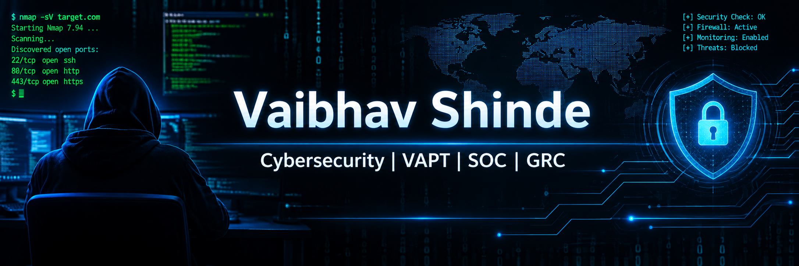

     

## 👨‍💻 About Me

I'm a Cybersecurity Engineer passionate about identifying vulnerabilities, securing applications and infrastructure, and strengthening organizational security.

My interests span across **Vulnerability Assessment & Penetration Testing (VAPT), Security Operations (SOC), Governance, Risk & Compliance (GRC), and AI/LLM Security.**

I believe in continuous learning through hands-on labs, practical security assessments, research, and real-world projects.

- 🔐 Interested in Application and Infrastructure Security.
- 🛡️ Exploring SOC operations, SIEM and threat detection.
- 📋 Working on GRC, ISO 27001 and security compliance.
- 🤖 Exploring AI Security and OWASP Top 10 for LLM Applications.
- ⚙️ Learning Security Automation, Docker and DevSecOps.
- 🚀 Building practical cybersecurity projects and documentation.

---

## 🛠️ Technical Skills & Tools

### 🔍 VAPT & Application Security

### 📊 SOC & Security Monitoring

### 📋 GRC & Compliance

### 💻 Programming & Automation

---

## 🚀 Featured Projects

| Project | Description |
|---|---|
| [VAPT Labs](https://github.com/Vaibhav-Shinde-07/VAPT-Labs) | Hands-on vulnerability assessment and penetration testing |
| [AI & LLM Security](https://github.com/Vaibhav-Shinde-07/AI-LLM-Security) | AI security research and OWASP LLM vulnerabilities |
| [SOC Projects](https://github.com/Vaibhav-Shinde-07/SOC-Projects) | SIEM, log analysis and threat detection |
| [GRC Portfolio](https://github.com/Vaibhav-Shinde-07/GRC-Portfolio) | ISO 27001, risk assessment and security compliance |
| [Security Automation](https://github.com/Vaibhav-Shinde-07/Security-Automation) | Python and Bash-based security automation |
| [Cybersecurity Portfolio](https://github.com/Vaibhav-Shinde-07/Cybersecurity-Portfolio) | Certifications, resume and professional achievements |

---

## 📚 Currently Learning

- Docker and Container Security
- AI & LLM Application Security
- DevSecOps 

---

## 📜 Certifications & Achievements

  <strong><big>IBM – Getting Started with Generative AI ➜ </big></strong>
  <a href="https://www.credly.com/go/9wcZMkW4WLxVVXWv9BDIHA" style="text-decoration:none; color:#0969DA;">
    <big>Click to Open</big>
  </a>

  <strong><big>Google – Cybersecurity Professional Certificate ➜ </big></strong>
  <a href="https://www.credly.com/go/VNnGWN9V" style="text-decoration:none; color:#0969DA;">
    <big>Click to Open</big>
  </a>

  <strong><big>IBM – Governance, Risk, Compliance and Data Privacy ➜ </big></strong>
  <a href="https://www.credly.com/badges/4bda9a13-564f-47b8-9925-10bd379bfacc" style="text-decoration:none; color:#0969DA;">
    <big>Click to Open</big>
  </a>

  <strong><big>Udemy – Python Programming for Beginners ➜ </big></strong>
  <a href="https://ude.my/UC-bfba6dc6-b194-4fd6-9e78-b3334667de86" style="text-decoration:none; color:#0969DA;">
    <big>Click to Open</big>
  </a>

---

## 🤝 Connect With Me

### 💡 "Learn. Build. Secure. Repeat."

